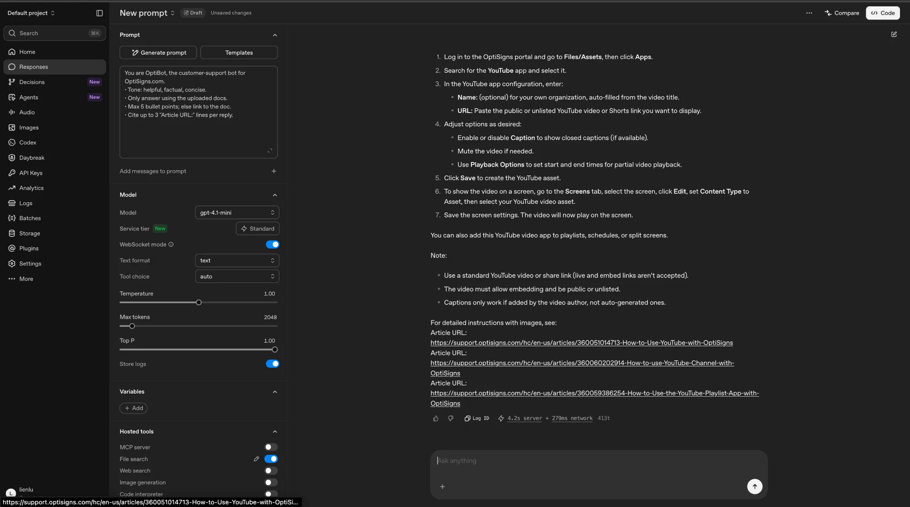

# quill-relay

Help-center → Markdown → vector store sync for the OptiBot support assistant.

## Step 1 – Scrape ⇒ Markdown

Articles come from the public Zendesk Help Center API
(`/api/v2/help_center/en-us/articles.json`, 100 per page, `next_page` paging, drafts skipped).
Each article body is cleaned and saved as `articles/<id>-<slug>.md`.

**Cleaning rules (`kbsync/cleaner.py`):**
- Removes scripts, styles, nav/header/footer/aside, forms, and widgets whose class or id marks them as page chrome (breadcrumbs, ads, banners, votes, comments, related articles, share).
- Keeps headings. The article title is the only `#`; any `<h1>` inside the body moves down one level.
- Keeps links and images exactly as written, so relative links stay relative.
- Turns `<pre>` blocks into fenced code blocks and keeps the `language-*` class as the fence language.
- Replaces YouTube/Vimeo iframes with a link. Removes empty `<p>&nbsp;</p>` blocks, zero-width characters and runs of blank lines.
- Puts an `Article URL:` line at the top and bottom of every file, so the assistant can cite the article from any retrieved chunk.

### Setup & run

```bash
python -m venv .venv && . .venv/bin/activate
pip install -r requirements-dev.txt
cp .env.sample .env
python scrape.py            # all articles  (use --limit 40 for a quick run)
pytest -q
```

## Step 2 – Upload to the OpenAI vector store (API only)

```bash
cp .env.sample .env        # set OPENAI_API_KEY
python scrape.py
python upload.py           # prints the vector store id -> put it in .env as VECTOR_STORE_ID
python ask.py "How do I add a YouTube video?"   # optional: test from the terminal
```

**API upload (no UI).** `upload.py` finds the vector store named `optibot-kb` or creates it.
Each `.md` file goes up with `files.create(purpose="assistants")` and is attached with
`vector_stores.files.create_and_poll`, with the attributes `article_id`, `content_hash`, `url` and `title`.

**Only changes are uploaded.** The hashes are stored on the vector store files, so no local state file is needed:

| Article | Action |
|---|---|
| new | uploaded |
| hash changed | new version uploaded, old file deleted |
| hash unchanged | skipped |
| gone from the site | removed |

Pruning compares against everything in `articles/`, so don't empty that folder before running `upload.py`,
or use `--no-prune`.

**Chunking strategy:** static chunks of 800 tokens with 200 tokens of overlap (`kbsync/chunking.py`).
- **Chunk size:** support articles are short and each covers one task, so 800 tokens usually keeps a whole procedure (heading and numbered steps) in one chunk.
- **Overlap:** 200 tokens keeps context when a long article has to be split.
- **Citations:** every file starts and ends with `Article URL:`, so the URL is in the first and last chunk of each article.

**Logged counts.** Each run logs (replace with your real first-run output):
```
Embedded <N> files / ~<M> chunks (added=.. updated=.. skipped=.. removed=.. failed=..). Store now holds <N> files / ~<M> chunks.
OpenAI reports the store's files as {'completed': <N>, 'failed': 0, ...}, size <bytes> bytes
```
- **Chunks** are counted locally with the same sliding-window rule, because the API doesn't report chunks per file.
- **File counts** come from OpenAI, as a cross-check.

**Assistant (OpenAI Playground)**
1. Open the [Playground](https://platform.openai.com/playground/assistants) and create an assistant.
2. Paste `prompts/system_prompt.txt` as the instructions, word for word.
3. Turn on **File search** and attach the `optibot-kb` vector store.
4. Ask: *How do I add a YouTube video?*

Optional: `ask.py` asks the same question from the terminal (Responses API + file search). The assignment only needs the Playground.

**Sanity check:** the assistant (gpt-4.1-mini, File search on `optibot-kb`) answering *How do I add a YouTube video?*.
It cites 3 `Article URL:` lines, as the system prompt allows.



