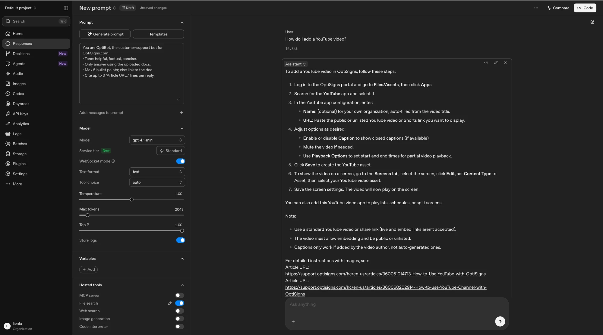

# quill-relay

Scrapes a Zendesk help center to clean Markdown, keeps an OpenAI vector store in sync (uploading only changed articles) and runs daily in Docker.

**Daily job logs:** [GitHub Actions › daily-sync](https://github.com/Ngocien/scraper/actions/workflows/daily-sync.yml). Open the latest run to see the log, the counts summary and the `last-run-N` artefact (`last_run.json` + `last_run.log`).

## Setup & run locally

```bash
python -m venv .venv && . .venv/bin/activate
pip install -r requirements-dev.txt
cp .env.sample .env                     # set OPENAI_API_KEY
python main.py                          # scrape + delta upload, then exit
pytest -q                               # tests (Zendesk and OpenAI are faked)

docker build -t kb-sync .
docker run --rm -e API_KEY=sk-... kb-sync   # runs once, exits 0 on success
```

Step by step: `python scrape.py` writes `articles/*.md`, and `python upload.py` uploads them. `python ask.py "question"` is an optional terminal test of the bot.

## How it works

**Scrape → Markdown** (`kbsync/scraper.py`, `kbsync/cleaner.py`)
- Pulls every published article from the Zendesk Help Center API, 100 per page.
- Saves each one as `articles/<id>-<slug>.md`.
- Removes nav, header/footer, scripts, ads, banners, breadcrumbs, vote/share/related widgets and empty paragraphs.
- Keeps headings, lists, tables, images and fenced code blocks (with their language). Links stay exactly as written, so relative links stay relative.
- Turns video iframes into links.
- Each file starts and ends with `Article URL: <url>` so any chunk can be cited.

**Vector store upload** (`kbsync/vector_store.py`), API only
- Uses `files.create` and then `vector_stores.files.create_and_poll`.
- Each file carries the attributes `article_id`, `content_hash` (SHA-256 of the Markdown) and `updated_at` (Zendesk's last-modified time).

**Chunking:** static chunks of 800 tokens with 200 tokens of overlap.
- Articles are short and each covers one task, so a whole procedure (heading and numbered steps) usually fits in one chunk.
- The overlap keeps context when a long article is split.
- The API doesn't report chunks per file, so the logged chunk count is calculated locally with the same window. The file count is cross-checked with OpenAI's `file_counts`.

**Daily delta** (`main.py`)
- Re-scrapes and compares each article's hash with the hash stored on the vector store file. The state lives in the store, so the container stays stateless.

| Article | Action |
|---|---|
| new | added |
| hash changed | updated (new file uploaded, then old one deleted) |
| same hash | skipped |
| gone from the site | removed |

Each run logs, for example:
`added=3 updated=1 skipped=<rest> removed=0 failed=0` and `Embedded 4 files / ~5 chunks this run; store holds <N> files`.

**Deployment:** `.github/workflows/daily-sync.yml` builds the Docker image and runs it every day at 02:17 UTC, with a manual "Run workflow" button. It needs the repository secrets `OPENAI_API_KEY` and `VECTOR_STORE_ID`. The same image runs on DigitalOcean, Render or Fly.io as a scheduled job.

## Assistant

Built in the OpenAI Playground: instructions = `prompts/system_prompt.txt` (verbatim), model gpt-4.1-mini, File search on the `optibot-kb` store.
*"How do I add a YouTube video?"*:



