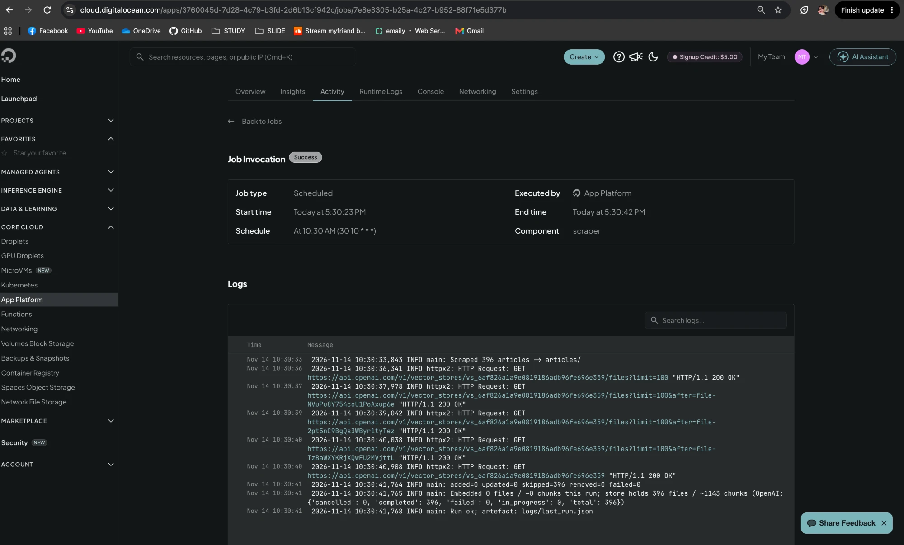

# scraper

Scrapes a Zendesk help center to clean Markdown, syncs it to an OpenAI vector store (uploading only changed articles) and runs daily in Docker.

**Daily job logs:** [DigitalOcean App Platform – job runs & logs](https://cloud.digitalocean.com/apps/3760045d-7d28-4c79-b3fd-2d6b13cf942c/jobs/7e8e3305-b25a-4c27-b952-88f71e5d377b) (needs account access), plus a screenshot of a run below.
Public backup run: [GitHub Actions › daily-sync](https://github.com/Ngocien/scraper/actions/workflows/daily-sync.yml).

## Setup & run locally

```bash
python -m venv .venv && . .venv/bin/activate
pip install -r requirements-dev.txt
cp .env.sample .env          # set OPENAI_API_KEY (or API_KEY); never commit .env
python main.py               # scrape + delta upload, logs counts, exits 0
pytest -q                    # 19 tests, Zendesk/OpenAI faked

docker build -t kb-sync .
docker run --rm -e API_KEY=sk-... kb-sync   # runs main.py once, exits 0
```

Individual steps: `python scrape.py` writes `articles/*.md`, and `python upload.py` uploads them. `python ask.py "…"` is an optional terminal test of the bot.

## How it works

- **Scrape**: the Zendesk Help Center API, 100 articles per page, saved as `articles/<id>-<slug>.md`.
  - Removes nav, header/footer, scripts, ads and widgets.
  - Keeps headings, lists, tables, images, fenced code blocks and links (relative links stay relative).
  - Each file starts and ends with `Article URL: <url>`, so any chunk can be cited.
- **Upload (API only)**: `files.create`, then `vector_stores.files.create_and_poll`. Each file carries the attributes `article_id`, `content_hash` and `updated_at`.
- **Chunking**: static chunks of 800 tokens with 200 tokens of overlap.
  - Articles are short and each covers one task, so a whole procedure usually stays in one chunk.
  - The overlap keeps context across splits in long articles.
  - The logged chunk count uses the same window, because the API doesn't report it. The file count is cross-checked with OpenAI.
- **Daily delta** (`main.py`):
  - Re-scrapes, then compares each article's SHA-256 with the hash stored on its vector store file, so the container stays stateless.
  - New article: **added**. Changed: **updated** (old file removed). Same: **skipped**. Gone from the site: **removed**.
  - Logs `added / updated / skipped / removed` and writes `logs/last_run.json`.
  - Latest DigitalOcean run: `Scraped 396 articles` · `added=0 updated=0 skipped=396 removed=0 failed=0` · `store holds 396 files / ~1143 chunks`.
- **Deploy**: `.do/app.yaml` is a DigitalOcean scheduled job (`kind: SCHEDULED`, `30 10 * * *` UTC) built from the Dockerfile.
  - `OPENAI_API_KEY` is an encrypted environment variable.
  - Bonus: `.github/workflows/daily-sync.yml` runs the same image at 14:17 UTC with public logs and a run artefact.
  - `tests.yml` runs the tests on every push.

## Assistant

Built in the OpenAI Playground: system prompt `prompts/system_prompt.txt` (verbatim), gpt-4.1-mini, File search on the `optibot-kb` store. *"How do I add a YouTube video?"*:


**Daily job run (DigitalOcean):**


